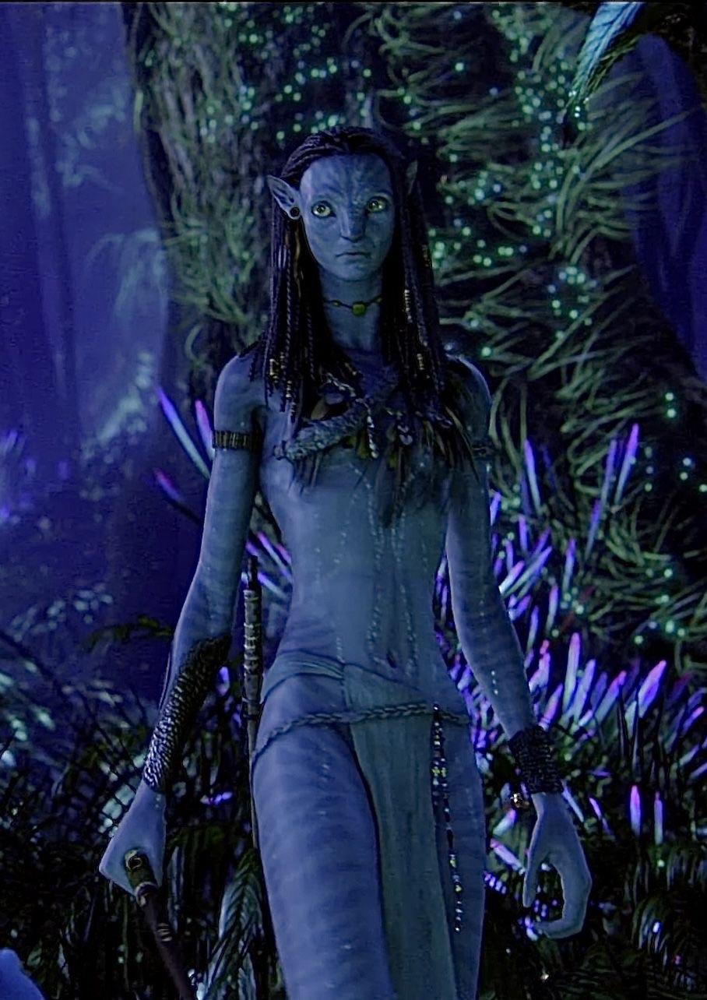

## Scriptwriting 
### From Script to Screen

Every page of a script is black and white. Color can only be written or described. That means the scriptwriter must clearly articulate their vision to those reading it. Here is an example of how this happens:

### Avatar (2009)
Script expert:

 > She is lithe as a cat, with a long neck, muscular shoulders, and nubile breasts. And she is devastatingly beautiful -- for a girl with a tail. In human ayears, she would be 18. Her name is NEYTIRI(nay-Tee-ree).
 
 This is the introduction to one of James Cameron's most popular characters in the blockbuster film *Avatar*. In the script, he had to paint an image in the readers' minds so they would envision what he did when he created Neytiri. 
### What James Cameron Saw
 
 
(An image of Neytitri)

[The Challenge of Scriptwriting](the-challenge-of-scriptwriting.md)

[Admired Scriptwriters](admired-scriptwriters.md)

[The Framework of a Script](the-framework-of-a-script.md)

[What Makes a Good Script](what-makes-a-good-script.md)