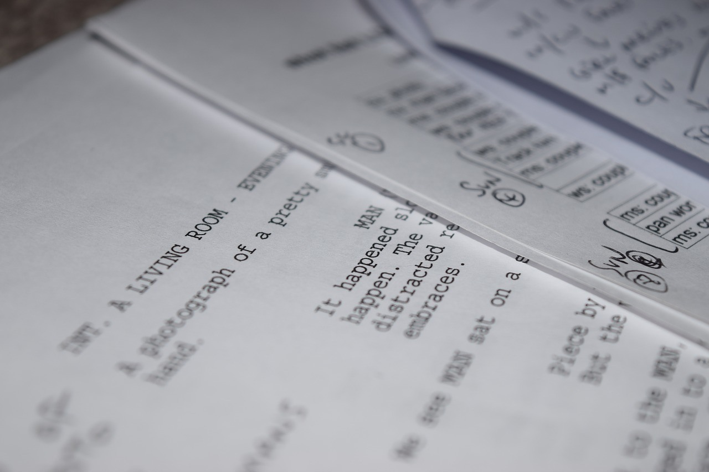

# Scriptwriting 
## The Challenge of Scriptwriting 

- Idea creation
- Breaking down moments to incredible detail
- Concise writing 

When people think of their favorite movie and TV show, they hardly consider where it started - where it really started. No cinematic work would exist without a screenplay or scripted lines. Even the most successful directors and actors rely on it. An empty page is where stories gain life. While this is an incredible and almost unexplainable gift, it also poses an immense challenge. 

Scriptwriters have to conceive and visualize a story, how it would translate to the screen, including beats, movements, and locations, and they face the challenge of breaking each scene down to the bare minimum: phrases and step-by-step movements. 

### Novel writing v/s Screenwriting

For example, when writing a novel, the author can take as much time as they like to transport you into a new world. In a script, paragraphs over three sentences aren't considered "within industry standards," and long descriptive paragraphs can turn many readers off from the project. So, whoever wrote your favorite film had to transport the director, producers, and actors into a world with a more restricted format. 

> _"To make a great film you need three things—the script, the script and the script."_ — Alfred Hitchcock 

[Admired Scriptwriters](admired-scriptwriters.md)

[The Framework of a Script](the-framework-of-a-script.md)

[From Script to Screen](from-script-to-screen.md) 

[What Makes a Good Script](what-makes-a-good-script.md)
