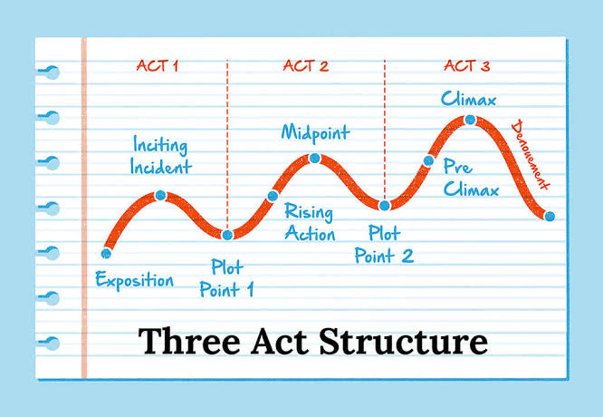

# Screenwriting
## The Framework of a Script

(Visual representation of a three-act structure)

### 1. Story Structure 
Most narrative scripts organize events into a progression of goals, obstacles, and outcomes:
- **Three-Act Structure:**
    - **Act I (Setup):** Introduces characters, setting, and the central conflict.
    - **Act II (Confrontation):** Builds tension as characters face escalating obstacles.
    - **Act III (Resolution):** Delivers the climax and resolves the central conflict.

- **Scenes and Sequences:** Individual scenes group into sequences to move the story forward with their own mini-arc.
### 2. Script Formatting Elements
To most people, scripts look a bit...strange. They include sluglines that indicate setting (`INT.` or `EXT.`), location, and time of day (e.g., `INT. COFFEE SHOP – DAY`); action lines that describe visible actions, settings, and physical movement in the present tense; and character names capitalized above spoken lines and parentheticals, brief delivery clues. These elements are outstanding because they give context in short and concise ways. 

>Without structure, a story can never be understood. 

[The Challenge of Scriptwriting](the-challenge-of-scriptwriting.md)

[Admired Scriptwriters](admired-scriptwriters.md)

[From Script to Screen](from-script-to-screen.md)

[What Makes a Good Script](what-makes-a-good-script.md)