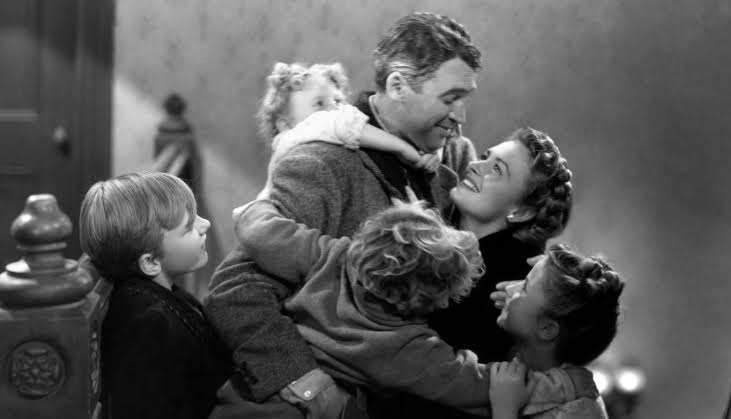

## Scriptwriting 
### What Makes A Good Script

(George Bailey and his family in *It's A Wonderful Life*)

There is no doubt it takes skill and determination to write a script. What classifies a script as good or bad is less straightforward. No genre is an automatic success. A romantic script won't inherently be any better than a comedy. 

### Key Factors for a Good Script 

- Its concept 
- Characters and arcs
- Emotional resonance 
- Coherent structure
- Intentional writing 

### Why This Matters 

1. The concept of a story is often why we watch it play out to begin with. It tells the audience what to expect, question, and anticipate. This is the perimeter for everything that follows.

2. Characters drive the course of the story. They are what makes the audience care about what is at risk for the protagonist or fictional world. When they are real and relatable, audiences see themselves in those on the screen, and a deep emotional bond is created. 

3. To make these stories take root in souls, writers have to create pressure, emotional ties, and loyalty between the characters and the audience. 

4. Emotional bonds can't survive through confusion. If the audience isn't being taken on a clear path, rest assured they will question everything. Suddenly, the characters no longer feel real.

5. All of this takes intentionality. Scriptwriters must write from the perspective of dozens of people: every character speaking, the audience, and themselves. A writer should never forget to write with their values in mind and be willing to sacrifice lines and scenes for the story. 

> A good script requires some novelty and loads of empathy.

[[the-challenge-of-scriptwriting|The Challenge of Scriptwriting]]
[[content/category-01/admired-scriptwriters|Admired Scriptwriters]]
[[content/category-01/the-framework-of-a-script|The Framework of a Script]]
[[content/category-01/from-script to-screen|From Script to Screen]]